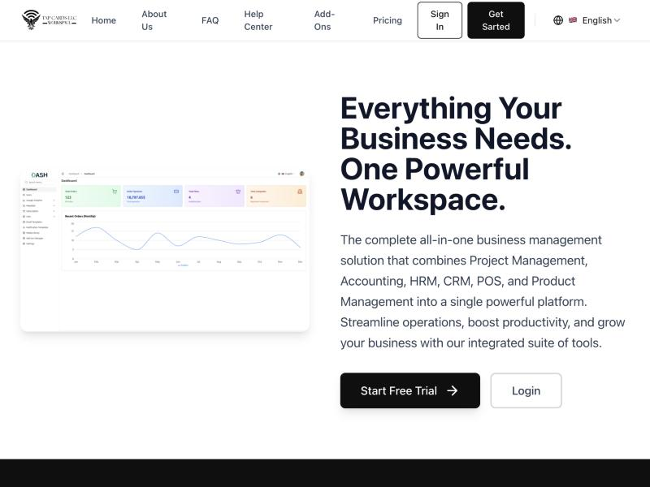

# Workspace — All-in-One Business Management Suite

> Everything your business needs. One powerful workspace.

**Workspace** is a SaaS business-management platform I built and operate under TapCards LLC. It brings the tools a small business juggles across many apps — **Project Management, Accounting, HRM, CRM, POS, and Product Management** — into a single dashboard.

🔗 **Live:** [workspace.tapcardss.com](https://workspace.tapcardss.com)

> This repository is a **case study** — the product is commercial, so the source isn't published here. It documents what the platform does and my role.

---

## What it does

- **Project Management** — plan work, track tasks, and keep teams aligned.
- **Accounting** — invoicing, expenses, and financial reporting.
- **HRM** — employees, attendance, and internal people operations.
- **CRM** — leads, contacts, and the sales pipeline.
- **POS** — point-of-sale for in-person transactions.
- **Product Management** — catalog and inventory in one place.
- **One dashboard** — a single login and shared data model across every module.

## My role

Founder & full-stack engineer — product direction, setup and configuration of the module suite, branding, deployment, and ongoing operations. Delivered as a multi-tenant SaaS with a public marketing site, pricing, and self-serve onboarding.

## Tech

**PHP · Laravel · MySQL · Multi-tenant SaaS**

---

© TapCards LLC. "Workspace" and its branding belong to TapCards LLC. This case study is for portfolio purposes.
